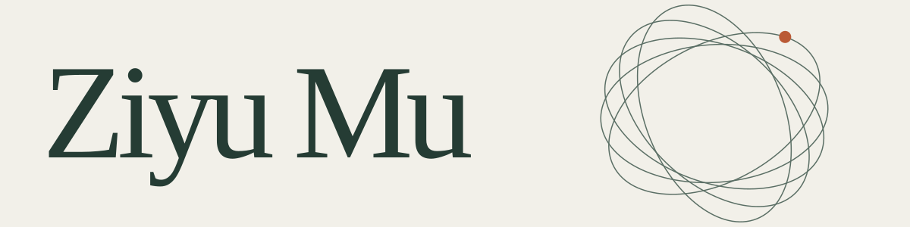

RESEARCH &amp; CODE &nbsp; / &nbsp; @MUUZZZIIY

<picture>
  <source media="(prefers-color-scheme: dark)" srcset="assets/header-dark.svg">
  <source media="(prefers-color-scheme: light)" srcset="assets/header-light.svg">
  
</picture>

Research interests Interpretability × AI Infrastructure

Model internals · ML systems · Research tools

## Selected work

2026 &nbsp; / &nbsp; PREPRINT &amp; CODE

### [Cross-Loop Query Handoff](https://github.com/Muuzzziiy/cql-handoff)

How later loops redirect two-hop retrieval in Ouro looped language models. Research code and frozen experiment records.

[Repository ↗](https://github.com/Muuzzziiy/cql-handoff) &nbsp;&nbsp; [Paper materials ↗](https://github.com/Muuzzziiy/cql-handoff/tree/main/paper) &nbsp;&nbsp; [Preprint notes ↗](https://github.com/Muuzzziiy/cql-handoff/blob/main/PREPRINT_NOTES.md)
